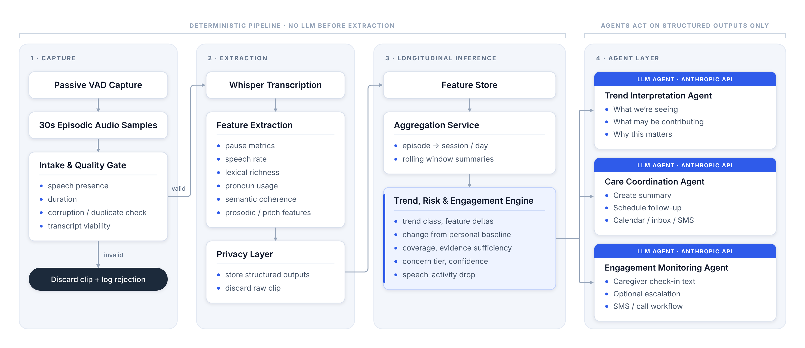

# Cadence - Longitudinal Speech Feature Modeling and Cognitive Trajectory Analysis

**Speech as a continuous digital biomarker for post-diagnostic Alzheimer's care.**

Cadence is a continuous functional monitoring platform that uses speech as a passive, high-frequency digital biomarker of cognitive and neurological change. It is built on one premise: clinically meaningful change shows up as a **pattern across repeated interactions**, not in any single assessment. Monitoring between clinic visits closes the measurement gap after diagnosis, where progression and treatment response are otherwise observed only at periodic visits.

*End-to-end Cadence pipeline, from passive capture to the agent layer.*

**Trained on 750+ recordings across heterogeneous speech settings, spanning structured elicitation tasks and naturalistic long-form conversation, Cadence models cognitive change with both clinical control and real-world variability.**

Headline results: an interpretable logistic regression reaches ROC AUC 0.917, and the dementia cohort's mean predicted MMSE-aligned score falls 6.1 points between visits 1 and 2 (19.3 to 13.2) while the control cohort stays within 15.2 to 17.7 across all four visits.

This repository contains the **modeling, statistical analysis, and longitudinal inference layer** of the Cadence pipeline. It operates on speech-derived features generated from structured and unstructured speech and focuses on feature-level interpretability, model performance, and trajectory-based reasoning rather than raw audio processing.

---

## Pitch Deck

The 8-slide Cadence pitch deck. Click the cover or [open the PDF](Cadence-Pitch-Deck.pdf).

---

## Results at a Glance

| Analysis | Result |
|---|---|
| Structured speech, feature families separating control from dementia | 6 of 6 at p < 0.001 |
| Unstructured speech, timing features | Average pause duration p = 0.044, pause frequency p = 0.046 |
| Feature ranking, features clearing p = 0.05 | Pause frequency, semantic coherence, average pause duration, speech rate |
| Classifier | Logistic regression, ROC AUC 0.917 |
| Longitudinal cohorts | 35 control, 37 dementia participants |
| Dementia cohort, mean predicted MMSE-aligned score | 19.3 at visit 1, 13.2 at visit 2 |
| Control cohort, mean predicted MMSE-aligned score | 15.2 to 17.7 across four visits |

---

## End-to-End System Context

In Cadence’s workflow, speech data is collected from both **structured speech tasks** and **naturalistic long-form conversational speech**. Audio is transcribed using **OpenAI Whisper** (via Wispr), producing timestamp-aligned transcripts that preserve temporal structure.

From these transcripts, Cadence extracts a rich set of **acoustic, lexical, semantic, and temporal features**, including pause frequency and duration, speech rate, lexical richness, pronoun usage, semantic coherence, and fundamental frequency characteristics. These features are computed consistently across speech contexts and consolidated into structured representations that serve as inputs to the modeling and longitudinal analysis pipeline implemented in this repository.

This architectural design enables Cadence to integrate controlled linguistic elicitation with real-world speech dynamics while maintaining interpretability and robustness.

---

## Scope of This Repository

This repository implements Cadence’s **core analytical logic**, spanning feature analysis, predictive modeling, and longitudinal trajectory inference.

The model is trained jointly on:

* **Structured speech tasks**, designed to elicit constrained linguistic behavior that amplifies cognitive signal, and
* **Naturalistic long-form conversational speech**, capturing unconstrained, real-world speech patterns.

By learning from both modalities, Cadence captures complementary aspects of cognitive function leveraging the sensitivity of structured tasks while retaining robustness to everyday speech variability.

---

## System Architecture

Cadence is built as a **deterministic pipeline with an agent layer on top**: everything from capture to longitudinal inference is rule-based and auditable, and language-model agents only interpret and act on its structured outputs.

The full pipeline is shown in the diagram at the top of this page.

**Quality gate.** A hard-coded intake service decides whether an episode is processable before any model runs: speech presence, minimum voiced duration, clipping and corruption, signal-to-noise estimate, transcript success, minimum token count, duplicate detection and metadata validity.

**Aggregation.** Episode-level features roll up into session, day and rolling-window summaries. For each window the layer computes coverage, consistency, within-window variability, change from the participant's personal baseline, change from the previous window, and evidence sufficiency, so that a trend is only reported when the underlying data supports it.

**Longitudinal reasoning.** A deterministic engine converts window summaries into a trend class (stable, subtle change, moderate decline, pronounced decline, or indeterminate), a concern tier, and a confidence level. Because it reasons on within-person deltas, it tracks change in each participant relative to their own baseline.

**Agent layer.** Three agents with non-overlapping jobs sit downstream of the engine, powered by the Anthropic API: one turns trend outputs into plain-language narrative for the care team, one handles care coordination (summaries and follow-up scheduling), and one monitors engagement and drafts caregiver check-ins. Agents receive only the engine's structured state, never raw features or audio, and any outreach to a clinic requires caregiver consent first.

**Principles.** No language model touches anything before extraction. Interpretability over opacity (a linear model with readable coefficients). Privacy by design (raw audio is deleted after feature extraction). Consent-gated actions. Modular stages, so transcription, feature extraction, modeling and agents can each be improved independently.

---

## Feature-Level Statistical Analysis

**All figures below this point were created by me from Cadence’s end-to-end evaluation runs and reflect observed model behavior across the full training/evaluation pipeline.**

Feature distributions are analyzed separately for structured and unstructured speech contexts using a combination of parametric and non-parametric statistical tests. Box-and-jitter visualizations compare control and dementia groups across multiple feature families, including lexical measures, pronoun usage, pause behavior, semantic metrics, and fundamental frequency.

In unconstrained conversation, where no task amplifies the signal, timing features still separate the groups: average pause duration (p = 0.044) and pause frequency (p = 0.046) remain significant, which shows that temporal structure carries signal outside controlled elicitation.

In structured speech tasks, all six feature families shown (lexical, pronoun, pause duration, semantic coherence, fundamental frequency, and pause frequency) separate control from dementia at p < 0.001. Controlled elicitation amplifies the linguistic and temporal differences that Cadence's models draw on.

---

## Feature Significance Ranking

To summarize feature relevance across analyses, features are ranked by statistical significance using −log₁₀(p-value). Four features clear the p = 0.05 threshold: pause frequency (p = 0.015), semantic coherence (p = 0.025), average pause duration (p = 0.028), and speech rate (p = 0.034). Timing and organization features lead the ranking, ahead of lexical and syntactic measures.

This ranking reinforces Cadence’s emphasis on **temporal structure and speech organization** as core signals, rather than relying exclusively on surface-level lexical counts.

---

## Predictive Modeling and Evaluation

An interpretable modeling pipeline is implemented using scikit-learn, consisting of:

* Mean imputation for missing values
* Feature standardization
* Logistic regression for binary classification

This design prioritizes transparency and coefficient interpretability over black-box performance.

Learned coefficients are directly readable: lexical features (2.68), pronoun usage (0.89), and fundamental frequency (0.48) carry the largest weights, while pause-related features contribute as stabilizing temporal signals. Coefficients come from the joint model, so they can rank features differently from the univariate tests above.

Evaluation includes ROC analysis and standard classification metrics. The logistic regression model reaches ROC AUC = 0.917, demonstrating that interpretable models can perform competitively when paired with well-shaped speech-derived features.

%20Curve.png)

---

## Longitudinal Cognitive Trajectory Modeling

Beyond cross-sectional classification, Cadence explicitly models **cognitive trajectories over time** by estimating predicted MMSE-aligned scores across repeated speech interactions, plotted against the standard MMSE impairment thresholds (24 and 18).

Individual-level trajectory plots illustrate how predicted cognitive scores evolve for each participant, revealing heterogeneous progression patterns, non-linear decline, and visit-to-visit variability that are not observable from single-timepoint predictions.

### Cohort-Level Trends

Aggregated trajectories (35 control and 37 dementia participants) separate by direction of change. Controls stay within a narrow band (15.2 to 17.7) across all four visits, while the dementia cohort's mean predicted score falls from 19.3 to 13.2 between visits 1 and 2, a 6.1-point decline. Because Cadence tracks within-person change, the quantity of interest is the change in each participant's predicted score across visits, not the absolute level at any single visit.

This trajectory-based framing reflects Cadence’s core design philosophy:  
**tracking change over time**, rather than producing static classifications.

---

## Why This Matters

Cognitive decline is gradual, heterogeneous, and often missed until late stages.

Cadence demonstrates that:

- speech can act as a passive, repeatable monitoring signal  
- longitudinal modeling captures within-person change that episodic screening misses  
- timing and organization encode more signal than vocabulary alone  

---

## Code Availability

This repository is an overview of Cadence's results. The analysis code and pipeline are kept private while the company is active. Reach out for a walkthrough.

---

## Status

Cadence is under active development, with the current system demonstrating strong discrimination (ROC AUC ≈ 0.92) and longitudinal signal extraction from speech across both structured tasks and naturalistic long-form conversation.

Next, Cadence is pursuing IRB approval for a first patient pilot with Yale's Alzheimer's Disease Research Unit. Ongoing work focuses on expanding longitudinal depth, improving robustness to speaker and recording variability, and refining individualized baselining to increase sensitivity to subtle within-subject change.

In clinical research and pharma trial settings, this approach can support high-frequency monitoring of cognitive trajectories to evaluate treatment response and disease progression alongside amyloid-beta–targeting therapies such as lecanemab and donanemab.

---

## Data and Privacy

All data used in this repository is synthetic or anonymized. No raw audio, transcripts, or personally identifiable information are included.

---

## Intellectual Property

© 2026 Cadence. All rights reserved.

This repository is made public for demonstration and evaluation purposes only.
No license is granted for use, modification, or redistribution of the code, methods, or system design.

---
